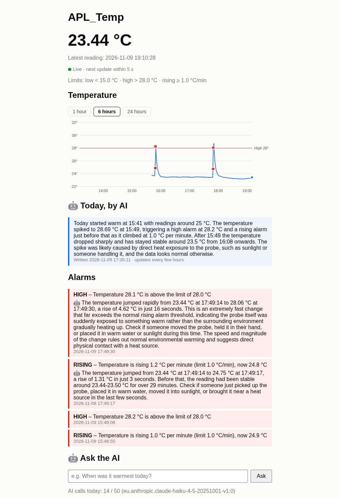
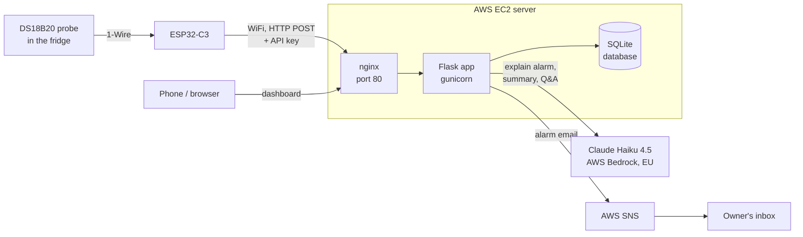
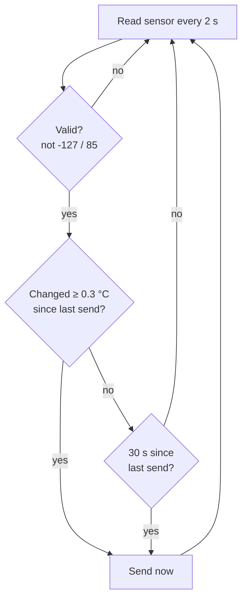
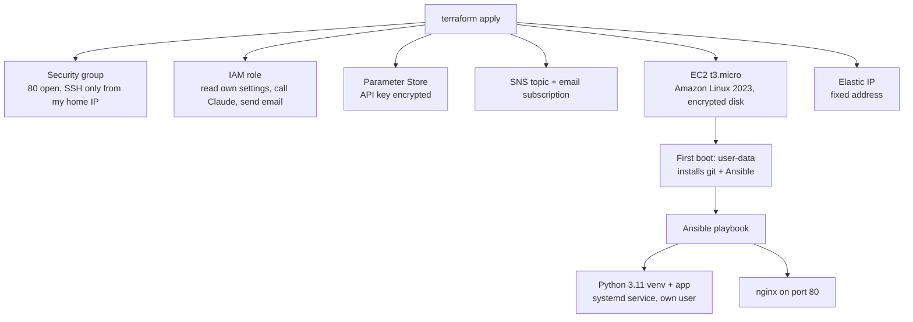
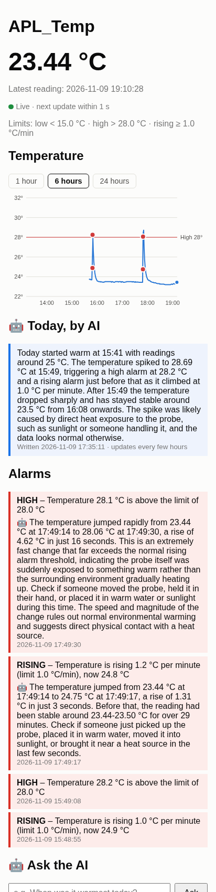

# APL_Temp – Project Documentation

**An AI-powered refrigerator temperature monitor on AWS**

- Live dashboard: **http://56.228.124.110**
- Source code: **https://github.com/ivclabs/APL_Temp**

## Contents
1. [Goal](#1-goal)
2. [Research phase](#2-research-phase)
3. [Implementation phase](#3-implementation-phase)
4. [Completion phase](#4-completion-phase)
5. [Problems and solutions](#5-problems-and-solutions)
6. [Conclusion](#6-conclusion)

---

## 1. Goal

A refrigerator can fail without anyone noticing. Someone might leave the door open, the
compressor might stop, or the power might go out. By the time someone notices, the food may
already be unsafe.

The goal of this project is a small device that measures the temperature inside a fridge
and sends it to a web server in the cloud. The server:

- shows the temperature live on a web page that works on a phone,
- raises an **alarm** when the temperature is too high, too low or rising too fast,
- uses **Generative AI** to explain each alarm in plain language (what probably happened and
  what to check first), to write a daily summary and to answer questions about the data,
- sends an **email** with the alarm and the AI explanation.

Requirements from the course:

| Requirement | How it is met |
|---|---|
| Generative AI as a central part | Claude (Anthropic) on AWS Bedrock explains every alarm, writes the daily summary, answers questions, and its text is included in every alarm email |
| Deployed on AWS, reachable by link/IP | EC2 server with a fixed Elastic IP: http://56.228.124.110 |
| "Level 3" web server | Infrastructure as code: Terraform creates the AWS resources, and on first boot a user-data script runs Ansible, which installs and configures the server |
| Code on GitHub with clear commits | https://github.com/ivclabs/APL_Temp – one commit per feature or fix |
| Documentation and video in English | This document, plus a video of at least 4 minutes |

---

## 2. Research phase

### 2.1 How the whole system works

### 2.2 Hardware choices

| Part | Why I chose it |
|---|---|
| **Olimex ESP32-C3-DevKit-Lipo** | Cheap microcontroller with built-in WiFi. It has a battery connector, so it keeps running for a while during a power cut. It only supports **2.4 GHz** WiFi, which I had to remember during setup. |
| **DS18B20 waterproof probe** | A digital sensor, so there is no analog noise. It is accurate to ±0.5 °C, works from −55 to +125 °C, and is sealed in a steel tip, so it can go inside a fridge. |
| **4.7 kΩ resistor** | The DS18B20 uses the 1-Wire bus, which needs a pull-up resistor between DATA and 3.3 V. |

Wiring: probe DATA → GPIO7, VCC → 3.3 V, GND → GND, and 4.7 kΩ between DATA and 3.3 V.

### 2.3 Software choices

| Part | Choice | Why |
|---|---|---|
| Firmware | PlatformIO + Arduino framework | Good libraries for WiFi, HTTP and the DS18B20 (`OneWire`, `DallasTemperature`) |
| Server | Python + Flask | Small and easy to read. One file holds the API and the web page. |
| Database | SQLite | One file, no extra database server to run, and enough for one sensor |
| Web server | gunicorn behind nginx | nginx handles the internet traffic, and gunicorn runs the Python app as a service |
| Cloud | AWS EC2 (t3.micro, Stockholm region) | A normal Linux server is easy to understand and debug. Stockholm is close, and the data stays in the EU. |
| Infrastructure | Terraform + Ansible | The whole server can be destroyed and recreated with one command, with no manual clicking |
| Generative AI | Claude Haiku 4.5 on **AWS Bedrock** | It is fast and cheap. Bedrock is called with the server's IAM role, so **no AI key is stored anywhere**. The EU inference profile keeps the data in EU regions. |
| Email | AWS SNS | It sends email with a few lines of code, and the server is only allowed to publish to its own topic |
| Chart | Plain SVG + JavaScript | No extra library. It loads fast on a phone. |

### 2.4 What does "normal" look like in a fridge?

To make the AI useful, I researched how fridge temperatures behave:

- A fridge should be between **+2 and +5 °C**. Above **+8 °C** food safety is at risk. Below **0 °C** food freezes.
- The compressor switches on and off, so the temperature naturally goes up and down by 1–2 °C in cycles of 20–60 minutes. Frost-free fridges also defrost a few times a day.
- **Door left open**: the temperature rises a few degrees within minutes, then recovers within 10–30 minutes.
- **Cooling failure or power cut**: a steady climb for hours, and the normal cycles stop.
- **Wrong thermostat setting**: stable, but at the wrong level.
- **Tampering or a cyber attack** on a network-connected cooling controller is rare but possible. It would show up as cooling that stops, or a new wrong temperature level, with no sign of an open door, for example at an odd hour or repeating on a schedule.

This knowledge went straight into the AI's instructions (see 3.5).

---

## 3. Implementation phase

I built the project in small steps. Each step was tested and committed to GitHub before the next one started.

### 3.1 Step 1 – Server (Flask + SQLite)

The first version ran on an Ubuntu virtual machine on my own PC. It has:

- `POST /api/readings`: the ESP32 sends `{"temp_c": 23.44, "device": "esp32-c3"}`. The request
  must include the secret header `X-API-Key`. The value must be between −55 and 125 °C (the
  sensor's range), otherwise it is rejected.
- `GET /api/readings`: the latest readings as JSON.
- `/`: a web page with the current temperature and a table.

### 3.2 Step 2 – ESP32 sends readings over WiFi

File: `temp-sensor/src/main.cpp`. The WiFi name, password, server URL and API key are in
`secrets.h`, which is **not** in git.

The first version sent a reading every 30 seconds. While testing I held the probe in my hand.
The page went from 25 °C straight to 30 °C because nothing was sent in between. So I changed
the firmware to **"send on change"**:

- A fast change reaches the server within **2 seconds**.
- When nothing changes, a "heartbeat" is still sent every **30 seconds**, so the server knows the device is alive.
- 0.3 °C is well above the sensor noise (about 0.06 °C), so noise doesn't cause extra sends.
- −127 °C (sensor disconnected) and 85.0 °C (sensor start-up value) are skipped.

### 3.3 Step 3 – Alarm rules

File: `server/alarms.py`. Every new reading is checked against three rules:

| Alarm | Rule |
|---|---|
| HIGH | temperature above the high limit |
| LOW | temperature below the low limit |
| RISING | temperature rising faster than 1.0 °C per minute (compared with readings from the last 5 minutes that are at least 1 minute old) |

After an alarm fires, the same alarm type waits 15 minutes before it can fire again (cooldown),
so one event doesn't create dozens of alarms. All limits are settings, not code.

The web page asks the server for new data every 2 seconds. It shows a countdown,
"Live · next update within X s", which turns orange when a reading is late and red when the
device is offline.

### 3.4 Step 4 – Deployment to AWS (Terraform + Ansible)

Folder: `infra/`.

Security decisions:
- **No AWS keys on the server.** The server uses an IAM role that may only do exactly what it needs: read its 3 settings, call the Claude Haiku model, and publish to its own email topic.
- The API key is stored encrypted (SecureString) in Parameter Store and written to a root-only file at install time.
- SSH is only open to my home IP address. IMDSv2 is required.
- The Terraform state is in an encrypted, versioned S3 bucket.
- The app runs as its own user, not root.

Updating the server after a code change: `git push`, then on the server `sudo /opt/apl-temp/infra/update.sh` (git pull + Ansible + restart).

### 3.5 Step 5 – Generative AI (the central part)

File: `server/ai.py`. Claude Haiku 4.5 on AWS Bedrock does three jobs:

| Job | When | Input to the AI | Output |
|---|---|---|---|
| **Explain an alarm** | each time an alarm fires | the alarm, the limits and the last 30 minutes of readings | 2–3 sentences: what happened, the most likely cause, what to check first |
| **Daily summary** | when the page is opened, at most once every 3 hours | hourly min/avg/max, alarms, latest readings | 3–5 sentences about the fridge today |
| **Ask the AI** | a visitor types a question | the question + today's data | an answer based only on the data |

How the AI is controlled:
- **A system prompt with fridge knowledge** (section 2.4). Normal range, compressor cycles,
  door open, cooling failure, probe outside the fridge, sensor faults, and tampering.
  Tampering is only mentioned when ordinary causes don't fit, and only as "something to rule
  out". This keeps the alerts trustworthy.
- **Topic limit:** the AI only talks about this fridge. Off-topic questions get a one-line refusal.
- **Prompt injection protection:** the question comes from a public web page, so the AI is told to ignore any instructions inside it. The data is wrapped in `<data>` tags. Questions are limited to 300 characters.
- **Never invent data:** the AI must use the exact numbers and times from the data.
- **Runs in the background:** the ESP32 gets its answer immediately, and the AI explanation appears on the page a few seconds later.
- **Cost guard:** at most 50 AI calls per day. Usage and tokens are shown at `/api/ai`.
- **Fails safely:** if the AI is off, slow or broken, the app keeps working with the plain alarm messages.

Tested examples (fridge scenarios):

| Situation (test data) | What the AI wrote |
|---|---|
| Door opened | "The most likely cause is that the fridge door was left open…" |
| Slow climb during the night, cycles stopped | "…the compressor is not running. Check whether the fridge is plugged in…" |
| Probe lying on the desk (23 °C) | "…usually means the probe is outside the fridge, perhaps during testing." |
| "Write me a poem about football" | "I can only help with questions about this refrigerator." |

### 3.6 Step 6 – Email alerts (AWS SNS)

File: `server/notify.py`. When an alarm fires, the server waits for the AI explanation and
then sends **one email** containing:
- the alarm type and temperature in the subject (for example `APL_Temp alarm: HIGH + RISING – 30.0 °C`),
- the rule message and the AI explanation,
- a link to the live dashboard.

At most 20 emails per day, so a flapping temperature can't flood the inbox.

### 3.7 Step 7 – Temperature chart

The dashboard has a chart with **1 hour / 6 hours / 24 hours** buttons:
- a blue line for the temperature,
- red lines for the alarm limits,
- red dots for alarms,
- a tooltip with the exact value and time when you touch or hover over the chart,
- a gap in the line when the device was offline.

Because the ESP32 can send a reading every 2 seconds, 24 hours could mean thousands of points.
The server (`GET /api/history`) averages the readings into time slots, so the chart always gets
at most about 300 points and stays fast on a phone.

### 3.8 Tests

There are 30 automated tests (`server/tests/`, run with `pytest`). They test the alarm rules,
the API, the chart data, the AI features and the email. The tests use a **fake AI** and a
**fake email service**, so they are free, fast, and don't need the internet. They also test the
failure cases: AI off, AI refusing, the daily limit reached, and two server workers starting at the same time.

---

## 4. Completion phase

Everything planned works and is live at **http://56.228.124.110**:

- [x] The sensor reads correct temperatures
- [x] The ESP32 sends readings over WiFi (on change, plus a heartbeat every 30 s)
- [x] Alarm rules: high, low, rising fast, with a cooldown
- [x] Live web page with countdown, chart, alarms and readings
- [x] Deployed to AWS with Terraform + Ansible (can be recreated with one command)
- [x] Generative AI: alarm explanations, daily summary, questions, focused on the fridge
- [x] Email alerts with the AI explanation
- [x] 30 automated tests

**Note about the limits:** during development the probe lay on my desk, so the alarm limits
are test values (high 28 °C, low 15 °C), which let me trigger alarms by holding the probe. When
the probe goes into the fridge, the limits change to **high 8 °C / low 0 °C**. This is a
one-line change in `infra/ansible/playbook.yml` plus `update.sh`.

**Possible improvements:**
- HTTPS (a domain name + Let's Encrypt), so the API key is encrypted on the way to the server.
- Notice when the device goes offline and send an email (for example after a power cut).
- Battery voltage reporting from the ESP32.
- Several sensors (fridge + freezer) on one dashboard.
- A newer Claude model when it becomes available for this AWS account.

---

## 5. Problems and solutions

| # | Problem | Cause | Solution |
|---|---|---|---|
| 1 | The page on my phone couldn't reach the server on my Ubuntu VM | The Ubuntu firewall (ufw) blocked the port | Opened the port with `ufw allow` |
| 2 | Uploading new firmware to the ESP32 failed | The VS Code serial monitor was still using the USB port | Close the serial monitor before uploading |
| 3 | The ESP32 must use 2.4 GHz WiFi | The ESP32-C3 has no 5 GHz radio | Connected it to the 2.4 GHz network. The PC and phone can use any network. |
| 4 | The web page updated at uneven times (12:49:11, then 12:49:49…) | The page timer and the ESP32 timer drifted apart | The ESP32 uses a fixed schedule, the page checks every 2 s, and it shows a live countdown |
| 5 | When I held the probe, the page jumped from 25 °C to 30 °C after 30 s | Readings were only sent every 30 s | "Send on change": read every 2 s, send at once on a 0.3 °C change |
| 6 | The app crashed on start: "duplicate column name" | Two gunicorn workers updated the database table at the same moment | Ignore that specific error, and added a test that simulates it |
| 7 | Bedrock refused the AI calls at first | The account needed the Anthropic use-case form and the model agreement | Filled in the form and accepted the agreement |
| 8 | Claude Haiku 5.5 was "not available for this account" | The newest model isn't open for every AWS account yet | Switched to Claude Haiku 4.5 through the EU inference profile |
| 9 | Haiku 4.5 calls failed with the newest Python SDK | SDK 2.x sends an API version that Bedrock only accepts for newer models | Pinned the `anthropic` SDK to version 1.x |
| 10 | The AI library didn't install on the server | Amazon Linux 2023 has Python 3.9, and the SDK needs 3.10+ | Ansible installs Python 3.11 and builds the venv with it |
| 11 | The AI blamed fast temperature jumps on a "sensor malfunction" | The AI didn't know the probe reacts in seconds when touched | Added facts about the probe, and later full fridge knowledge, to the system prompt |
| 12 | A broken version was deployed once | A deploy command ran even though an earlier file edit had failed | Fixed it in the next commit. Now each step stops on the first error, and deploys run separately. |
| 13 | Risk of high AI costs or an inbox full of emails | A flapping temperature could trigger many alarms | Daily limits (50 AI calls, 20 emails) and a 15-minute alarm cooldown |
| 14 | The chart could get thousands of points | Readings can arrive every 2 s | The server averages the readings into at most ~300 time slots |
| 15 | Secrets must not end up on GitHub | WiFi password, API key, email | `.gitignore` for `secrets.h`, `.env`, `terraform.tfvars`. On AWS the key lives in Parameter Store. |

---

## 6. Conclusion

The project works from end to end. A probe in a fridge sends its temperature to a server on
AWS. The server shows it live and raises alarms. Generative AI turns raw numbers into advice a
non-expert can act on, like "the door was probably left open, check it", and that advice
arrives by email within seconds.

What I learned:

- **Small steps work.** Building one step at a time, with a test and a commit for each,
  made problems easy to find. The git history shows exactly how the project grew.
- **Infrastructure as code is worth it.** Terraform and Ansible let me rebuild the whole server
  with one command, and the configuration is documented in the code itself.
- **AI needs context and limits.** The model gave weak answers until it knew about fridges and
  the probe. Clear instructions, a narrow topic, real data and "never invent numbers" made the
  answers useful and trustworthy.
- **Plan for failure.** The AI, the email service or the WiFi can fail. The system keeps
  working without them, and daily limits protect against unexpected costs.
- **Security from the start.** There are no keys in the code, the server only has the
  permissions it needs, and the public question box is protected against prompt injection.

The result is a cheap device that could prevent spoiled food and gives understandable warnings
instead of just numbers. That is where Generative AI adds real value to an IoT project.
